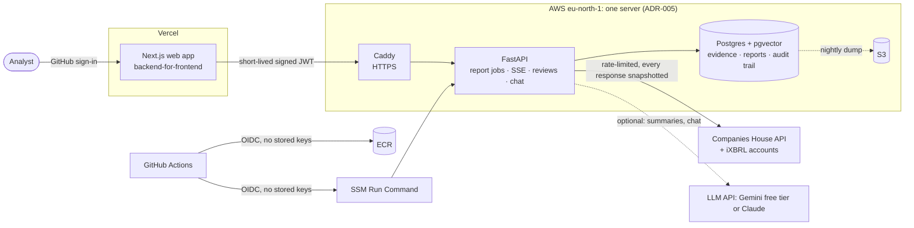

# KYB Due-Diligence Agent (UK)

Enter a UK company number and get a **structured, cited risk report** that a compliance
analyst reviews and approves: the Know-Your-Business check fintechs run before onboarding
a business customer.

**Live:** [ukco-kyb.vercel.app](https://ukco-kyb.vercel.app) (GitHub sign-in, invite-only) ·
API on AWS · **v1 shipped** after 18 days of a [3-week plan](docs/PLAN.md); evals and
observability next.

## What the report contains
1. **Snapshot:** status, age, SIC codes, registered-office history, officers, people with significant control.
2. **Red flags**, each with severity, a one-line explanation, and a citation to the exact source
   (API record or filing page):
   **insolvent, closed or being struck off (a knockout)** · overdue accounts / confirmation
   statement · director churn · officers linked to many failed companies · recent ownership
   (PSC) changes · frequent office moves · very new company in a high-risk sector · financial
   deterioration in filed accounts.
3. **Risk score (0–100)** with every contributing reason; a knockout sets it to 100.
4. **Review:** the analyst confirms or dismisses each flag (dismissing needs a written reason), then approves or rejects the customer (only once every flag is reviewed). Every decision goes into an append-only audit trail.

**Design principle:** deterministic rules for everything computable from register data; the
LLM only where it adds value (explanations, summaries, reading PDF-only accounts).
Why and how: [ADR-004](docs/adr/0004-pivot-to-kyb-due-diligence.md).

**Evaluation:** rules are checked against hand-labelled companies, and the risk score is
back-tested *as of* a past date against what actually happened (compulsory strike-off,
liquidation, administration) in the following 18 months.

> Demo only, not financial or compliance advice. Uses public Companies House data.

## Architecture



| Layer | What's built |
|---|---|
| Data | Async Companies House client (rate limit, retries, cache); every response stored as evidence with a content hash |
| Financials | iXBRL parser for filed accounts (no OCR needed for most small companies, [ADR-004](docs/adr/0004-pivot-to-kyb-due-diligence.md)) |
| Risk engine | 9 deterministic rules, point-in-time (`as_of`), versioned [`risk_policy.yaml`](backend/src/ukco/risk/risk_policy.yaml); every flag cites its records |
| LLM | Gemini (free tier, via any OpenAI-compatible API) or Claude for the summary and per-flag explanations (structured output, citation-checked), and a "why is this flagged?" chat agent with read-only tools. Off without a key; reports are complete without it |
| Review | Confirm/dismiss flags, approve/reject; append-only audit trail enforced by a DB trigger |
| Interfaces | FastAPI (SSE progress), Next.js web app, CLI, MCP server |
| Evals | Point-in-time outcome back-test on a frozen snapshot, AUC gate in CI |
| Observability | OpenTelemetry → Langfuse; per-report timings, Companies House call counts, cost |
| Infra | Terraform, Docker, GitHub Actions CI + deploy (OIDC), Vercel |

Data model: [docs/data-model.md](docs/data-model.md) · API rate budget:
[docs/companies-house-api.md](docs/companies-house-api.md) · Decisions: [docs/adr/](docs/adr/).

## Trade-offs (and what I'd change at scale)

- **One server, not ECS + RDS + load balancer** ([ADR-005](docs/adr/0005-lean-single-server-hosting.md)):
  about $10/month instead of about $50. It costs a minute of downtime per deploy and has no
  failover; backups are nightly (lose at most a day). The image and settings don't change
  if it moves to ECS, so scaling up is an infrastructure change, not a rewrite.
- **Rules first, LLM second:** a compliance team must be able to explain every flag to an
  auditor, so the score never depends on a model. The LLM explains; it doesn't decide.
- **Report jobs run inside the API process:** simple, and fine at demo volume; a queue and
  workers come before any real traffic.
- **The risk score is a weak predictor so far.** On 100 held-out companies it ranks those that
  went on to fail barely above chance (AUC 0.57, below). It's measured honestly against what
  actually happened to companies, and beating it is the current milestone.

## Run locally

Prerequisites: Docker, [uv](https://docs.astral.sh/uv/), a free
[Companies House API key](https://developer.company-information.service.gov.uk/).

```bash
make setup            # install deps + git hooks, create .env
make up               # start Postgres + pgvector
make migrate          # create the schema
make doctor           # verify DB, schema and a live API call
make ingest-metadata  # companies, officers, filing history for the seed list
make test
```

Run the web app (sign in with the local dev login, then search for a company):

```bash
make api        # terminal 1: API on :8000
make web        # terminal 2: web app on :3000 (copy web/.env.example to web/.env.local first)
```

Or generate a report from the command line, or use the API directly:

```bash
cd backend && uv run ukco report 13235004    # → reports/13235004_<date>.md + .json
make api                                     # → http://localhost:8000/docs
```

| Endpoint | |
|---|---|
| `POST /reports` | Queue a report (`{"company_number": "…", "as_of": "YYYY-MM-DD"?}`) → 202 |
| `GET /reports/{id}/events` | Server-sent progress: queued → fetching → … → succeeded |
| `GET /reports/{id}` | Status, the full cited report, current review decisions |
| `POST /reports/{id}/reviews` | Confirm/dismiss a flag, approve/reject the report |
| `GET /reports/{id}/reviews` | Append-only audit trail (UPDATE/DELETE blocked by a DB trigger) |
| `POST /reports/{id}/chat` | Ask about a report (`{"question": "…", "conversation_id"?}`); streamed answer with citations |
| `GET /reports/{id}/chat/{conversation_id}` | A conversation's transcript (your own only) |

## Assistants (MCP) and observability

- **"Why is this flagged?" chat:** on the report page, an analyst can ask about the report.
  The model answers only from that report, using four read-only tools (a flag's cited records with
  their values, a check's policy thresholds, the company snapshot, the review history). Answers
  cite `[E3]`/`[F1]`; citations not in the report are flagged in the UI. Conversations are
  append-only and kept with the report (a DB trigger blocks edits), replayed verbatim each turn.
  Off unless `LLM_API_KEY` (free Gemini, or any OpenAI-compatible API) or `ANTHROPIC_API_KEY` is set; capped at `CHAT_DAILY_QUESTIONS` per user per day.
- **MCP server:** `uv run ukco mcp` exposes `search_companies`, `get_risk_report`,
  `get_flag_evidence` and `officer_network` to Claude Desktop / Claude Code. Setup: [docs/mcp.md](docs/mcp.md).
- **Tracing:** OpenTelemetry, exported to Langfuse (or any OTLP backend) when keys are set. One
  trace per report, with a span per stage and the LLM call as a generation (model, tokens,
  cost). Every report also records its own stage timings, Companies House request count and
  trace id. Prompt content isn't exported unless `TRACE_CONTENT=true` (it names officers).

## Deployment

Live: web app on Vercel, API on one small AWS server in `eu-north-1`
([ADR-005](docs/adr/0005-lean-single-server-hosting.md), about $10/month).

- **Infrastructure:** Terraform in [`infra/terraform`](infra/terraform): VPC, one Graviton
  instance (no SSH; admin via SSM), encrypted data volume, ECR, nightly database dump to S3,
  budget alerts. `make tf-plan` / `make tf-apply`.
- **Stack on the server:** [`deploy/compose.yml`](deploy/compose.yml): Caddy (automatic
  HTTPS) → API → Postgres, with migrations run before each start.
- **Deploys:** after CI passes on `main`, [`deploy.yml`](.github/workflows/deploy.yml) builds
  the arm64 image, pushes it to ECR and has the server pull and restart, then checks
  `/health` over HTTPS. GitHub authenticates to AWS with OIDC (no stored keys), and only
  `main` can assume the role. `make deploy` does the same by hand.
- **Secrets:** SSM Parameter Store (`make secrets`), written to the server's `.env` at
  deploy time; never in git or the image.
- **Access:** GitHub sign-in with an allow-list (`AUTH_ALLOWED_USERS`), plus daily per-user
  and site-wide limits on reports and chat.

## Smoke test

Six real companies on the live system ([docs/smoke-test-v1.md](docs/smoke-test-v1.md)): all
succeeded in under 2 s. It also caught a critical gap before launch: a company **in
liquidation** scored 0, because nothing checked the company's own status. It's now a knockout
rule, with a regression test.

## Eval results

Scored **as of 30 Sep 2024** using only what was known then; outcome = compulsory strike-off
or insolvency in the next 18 months. Real companies, frozen snapshots, no live API calls.
Three sets: **dev-v1** (400 companies), which rules and weights are developed on; **v0**
(60), the regression check CI runs on every PR; and **test-v1** (100 different companies),
held out: run rarely, every run logged.
Method and caveats: [evals/README.md](evals/README.md).

| Metric | test-v1, policy v3 | **test-v1, policy v4** | dev-v1, policy v4 |
|---|---|---|---|
| Risk score vs adverse outcome | 0.57 [0.47, 0.67] | **0.66** [0.55, 0.76] | 0.69 [0.64, 0.74] |
| …without filing-deadline flags | 0.50 [0.41, 0.59] | **0.60** [0.49, 0.71] | 0.62 [0.57, 0.68] |
| …insolvency vs survived only | 0.62 [0.48, 0.76] | **0.67** [0.53, 0.81] | 0.66 [0.58, 0.73] |

Takeaway: the v3 rules saw distress that was already visible (overdue filings) and little
else: on fresh companies they were barely better than chance. Policy v4 adds a **late filing
history** rule (a habit of filing late, not just overdue today), looks at director changes
over 24 months, and sets each rule's points from data (fitted on dev-v1 only). On the
held-out set it rose to 0.66, and to 0.60 without the deadline flags. That's a modest,
honest triage signal, not a prediction; the intervals are wide at 100 companies.
