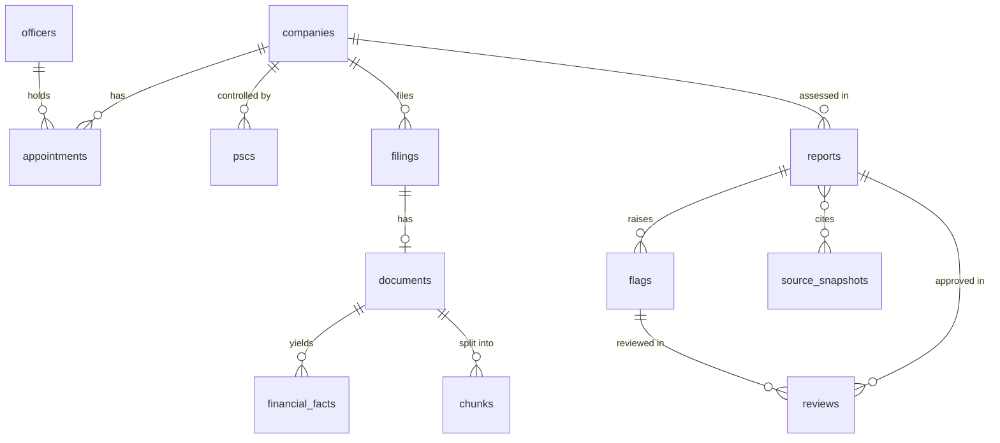

# Data model (v2, KYB)

Two layers: **register data** (normalised Companies House records, upserted idempotently)
and **decision data** (reports, flags, reviews: append-only, never rewritten).



## Register data
| Table | Key | Notes | Status |
|---|---|---|---|
| `companies` | `company_number` | Full profile **or stub** (`profile_fetched_at` null) for companies only seen via an officer's appointments. Adds `accounts_next_due`, `last_accounts_made_up_to`, `cs_next_due`, `registered_office_is_in_dispute`, `has_been_liquidated`, `previous_names` | adapt |
| `officers` | `officer_id` | **The person.** Name, `is_corporate`, total/active/resigned appointment counts, `appointments_fetched_at`, `appointments_truncated` | new |
| `appointments` | `(company_number, officer_id, role, appointed_on)` | **Person ↔ company edge**, from both the company's officer list and the officer's appointment list. `appointment_id` nullable (only the company side has it). This is the director network | **rename + adapt** of Day 3 `officers` |
| `pscs` | `(company_number, psc_id)` | Kind (individual/corporate/legal person), name, `natures_of_control[]`, `notified_on`, `ceased_on`. Plus `psc_statements` rows | new |
| `filings` | `(company_number, transaction_id)` | Unchanged. `AD01` → office history, `GAZ1`/`DS01` → outcomes, `AA` → accounts | keep |
| `office_changes` | view over `filings` where `type = 'AD01'` | `change_date`, `old_address`, `new_address` from `description_values` | new (view) |
| `documents` | `document_id` | Adds `format` (`ixbrl`/`pdf`) | keep |
| `financial_facts` | `(document_id, metric, period_end)` | `value`, `unit`, `source` (`ixbrl` tag name or `ocr_llm` page), `extractor_version`, `confidence` | new |
| `chunks` | `(document_id, chunk_index)` | For chat/evidence search; embedding column arrives when needed | keep |
| `source_snapshots` | `id`; unique `sha256` | Raw API response body, `path`, `params`, `fetched_at`. What citations point at | new |
| `ingestion_runs` | `id` | Unchanged | keep |

## Decision data (append-only)
| Table | Key | Notes |
|---|---|---|
| `reports` | `id` | `company_number`, `as_of`, `risk_score`, `status` (draft → in_review → approved/rejected), `payload` (JSONB, Pydantic `RiskReport`), `rules_version` (git sha + policy hash), `model_id`, `prompt_version`, `cost_usd`, `latency_ms`, `trace_id` |
| `flags` | `id` | `report_id`, `flag_type`, `severity`, `points`, `explanation`, `evidence` (JSONB list of citations), `detector` (`rule`/`llm`) |
| `reviews` | `id` | `target` (flag or report), `target_id`, `decision` (confirm/dismiss/approve/reject), `note`, `reviewer`, `created_at`, plus `rules_version`/`model_id` copied from the report. **Insert-only**: the current decision is the latest row |
| `watchlist` | `company_number` | Phase 2: Airflow re-runs reports nightly and alerts on new flags |

## Citation format
```json
{"kind": "api", "snapshot_id": 812, "pointer": "/items/3/resigned_on", "url": "https://find-and-update.company-information.service.gov.uk/company/13237895/officers"}
{"kind": "document", "document_id": "abc…", "page": 7, "element": "ix:nonFraction#NetAssetsLiabilities"}
```
A validator rejects any report whose citations don't resolve to a stored snapshot/document.

`ukco.evidence.EvidenceIndex` maps facts to citations when a bundle is persisted, e.g.
`("filing", n, transaction_id)`, `("appointment", n, officer_id, role, appointed_on)`,
`("psc", n, psc_id)`, `("network", officer_id, linked_n, role, appointed_on)`, and
`("register", path)` for absences such as "no insolvency on file". Each fetch is an
`ingestion_runs` row whose `manifest` lists its snapshot ids, so a report can be replayed.
